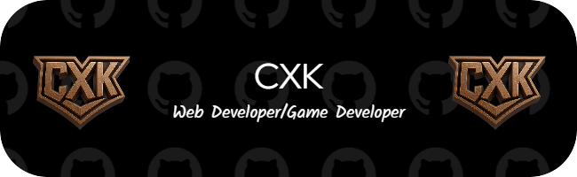

  

    
  

  <picture>
    <source media="(prefers-color-scheme: light)" srcset="https://www.gitskins.com/api/section/wordmark?username=cxkcalvin&theme=aurora&avatar=https%3A%2F%2Favatars.githubusercontent.com%2Fu%2F180308009%3Fu%3Da43a019c361d95bdf62d780b1f6fbf4fe1a0d972%26v%3D4&label=CXK_calvin&v=cinematic-hero-wordmark-1&mode=light" />
      
  </picture>

  <!-- Profil 1 -->
  <picture>
    <source media="(prefers-color-scheme: dark)" srcset="https://www.gitskins.com/api/section/neofetch?username=cxkcalvin&theme=github-dark&avatar=https%3A%2F%2Favatars.githubusercontent.com%2Fu%2F180308009%3Fu%3Da43a019c361d95bdf62d780b1f6fbf4fe1a0d972%26v%3D4&role=Frontend+or+full-stack+engineer&mode=dark" />
    
  </picture>

  <!-- Profil 2 -->
  <picture>
    <source media="(prefers-color-scheme: dark)" srcset="https://www.gitskins.com/api/section/hero?username=cxkcalvin&theme=aurora&avatar=https%3A%2F%2Favatars.githubusercontent.com%2Fu%2F180308009%3Fu%3Da43a019c361d95bdf62d780b1f6fbf4fe1a0d972%26v%3D4&variant=living-identity&label=CXK_calvin&v=wow-living-identity-1&mode=dark" />
    
  </picture>
        

<!-- Profil Ketiga -->
<!--  -->

<!-- Profil 4 -->
  <!-- 

    
  
  -->

<!-- Profil 5 -->

<!--  -->

<!-- Profil  6 -->

  

<!-- Profil 7 -->
<!-- <picture>
    <source media="(prefers-color-scheme: dark)" srcset="https://www.gitskins.com/api/section/system-scan?username=cxkcalvin&theme=neon&avatar=https%3A%2F%2Favatars.githubusercontent.com%2Fu%2F180308009%3Fu%3Da43a019c361d95bdf62d780b1f6fbf4fe1a0d972%26v%3D4&style=terminal&v=oss-system-scan-1&mode=dark" />
    
  </picture> -->

  

    
  

  

    
  

  

### `01` Skill

  

  
  
  
  
  
  
  
  
  
  
  
  
  
  
  

### `02` Statistik Github Saya

<table border="0">
  <tr>
    <td>
      
    </td>
    <td>
      
    </td>
  </tr>
</table>

### `03` Media Saya

  
  
  

 

  **Spotify** 
  

### `04` Cihuyyy 🤍

  <table border="0">
    <tr>
      <td>
        
      </td>
      <td>
        
      </td>
      <td>
        
      </td>
    </tr>
  </table>

  

<picture>
  <source media="(prefers-color-scheme: dark)" srcset="https://www.gitskins.com/api/section/stack?username=cxkcalvin&theme=aurora&avatar=https%3A%2F%2Favatars.githubusercontent.com%2Fu%2F180308009%3Fu%3Da43a019c361d95bdf62d780b1f6fbf4fe1a0d972%26v%3D4&variant=wow&v=wow-stack-1&mode=dark" />
  
</picture>    

  

Visitors
    

<!-- commit 1 -->
<picture data-importer="pacman">
  <source media="(prefers-color-scheme: dark)" srcset="https://raw.githubusercontent.com/CXKcalvin/CXKcalvin/pacman-output/pacman-contribution-graph-dark.svg">
  <source media="(prefers-color-scheme: dark)" srcset="https://raw.githubusercontent.com/CXKcalvin/CXKcalvin/pacman-output/pacman-contribution-graph.svg">
  
</picture>  

<!-- commit 2 -->
<!-- <picture>
  <source media="(prefers-color-scheme: dark)" srcset="https://www.gitskins.com/api/section/heatmap?username=cxkcalvin&theme=aurora&avatar=https%3A%2F%2Favatars.githubusercontent.com%2Fu%2F180308009%3Fu%3Da43a019c361d95bdf62d780b1f6fbf4fe1a0d972%26v%3D4&style=snake&v=cinematic-snake-1&mode=dark" />
  
</picture> -->

<!-- Commit 3 -->

  

My Commit
 

<picture>
  <source media="(prefers-color-scheme: dark)" srcset="https://www.gitskins.com/api/section/projects?username=cxkcalvin&theme=neon&avatar=https%3A%2F%2Favatars.githubusercontent.com%2Fu%2F180308009%3Fu%3Da43a019c361d95bdf62d780b1f6fbf4fe1a0d972%26v%3D4&repos=cxkcalvin%2Fwarung-game%2Ccxkcalvin%2Fportofolio%2Ccxkcalvin%2FKerja_Kelompok_part_1&v=oss-projects-1&mode=dark" />
  
</picture>

<picture>
  <source media="(prefers-color-scheme: dark)" srcset="https://www.gitskins.com/api/section/projects?username=cxkcalvin&theme=aurora&avatar=https%3A%2F%2Favatars.githubusercontent.com%2Fu%2F180308009%3Fu%3Da43a019c361d95bdf62d780b1f6fbf4fe1a0d972%26v%3D4&repos=cxkcalvin%2Fwarung-game%2Ccxkcalvin%2Fportofolio%2Ccxkcalvin%2FKerja_Kelompok_part_1&variant=wow&v=wow-projects-1&mode=dark" />
  
</picture>

<picture>
  <source media="(prefers-color-scheme: dark)" srcset="https://www.gitskins.com/api/section/projects?username=cxkcalvin&theme=aurora&avatar=https%3A%2F%2Favatars.githubusercontent.com%2Fu%2F180308009%3Fu%3Da43a019c361d95bdf62d780b1f6fbf4fe1a0d972%26v%3D4&repos=cxkcalvin%2Fwarung-game%2Ccxkcalvin%2Fportofolio%2Ccxkcalvin%2FKerja_Kelompok_part_1&variant=wow-timeline&v=wow-timeline-1&mode=dark" />
  
</picture>

### `05` Minigame

<picture>
  <source media="(prefers-color-scheme: dark)" srcset="https://www.gitskins.com/api/section/chess?username=cxkcalvin&theme=aurora&avatar=https%3A%2F%2Favatars.githubusercontent.com%2Fu%2F180308009%3Fu%3Da43a019c361d95bdf62d780b1f6fbf4fe1a0d972%26v%3D4&v=cinematic-chess-1&mode=dark" />
  
</picture>

  

 &copy;2026 CXK(Cipta Xtra Karya)

<!-- Last Auto-Update: 2026-10-27 02:59:15 -->
